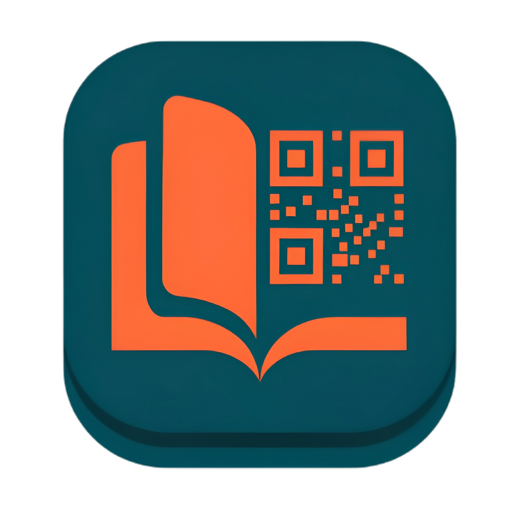

<div align="center">



# TamuQ — Smart Library Guestbook & Management System

### *Ekosistem Digital Terintegrasi untuk Layanan Perpustakaan JTIK UNM*

<br/>

[](https://github.com/MuhammadIkramM/TamuQ-Production)
[](https://github.com/MuhammadIkramM/TamuQ-Production)
[](https://github.com/MuhammadIkramM/TamuQ-Production/commits)
[](#️-hak-cipta)
[](./LICENSE)
[](https://github.com/MuhammadIkramM/TamuQ-Production)

<br/>

> **"Dari buku tamu kertas ke ekosistem digital terintegrasi — TamuQ hadir untuk masa depan perpustakaan kampus."**

<br/>

[📦 Frontend](#-tamuq-frontend--antarmuka-pengguna) · [⚙️ Backend](#️-tamuq-backend--layanan-api) · [🏗️ Arsitektur](#️-arsitektur-sistem) · [🔒 Keamanan](#-arsitektur-keamanan) · [⚖️ Hak Cipta & Lisensi](#️-hak-cipta)

</div>

---

## 📖 Tentang Repositori Ini

Repositori ini adalah **monorepo** dari platform **TamuQ** — sistem manajemen perpustakaan cerdas berbasis web yang dikembangkan khusus untuk **Jurusan Teknik Informatika dan Komputer (JTIK), Universitas Negeri Makassar (UNM)**.

TamuQ lahir dari kebutuhan transformasi digital di lingkungan perpustakaan kampus — menggantikan proses manual yang lambat dan rawan kesalahan dengan solusi digital yang efisien, andal, dan modern.

Repositori ini mengandung dua layanan utama yang bekerja bersama dalam satu ekosistem terintegrasi:

| Layanan | Teknologi | Peran |
|---|---|---|
| 📦 **`tamuq-frontend`** | Vue.js 3, Vite, Tailwind CSS | Antarmuka Pengguna, E-Skripsi & Staff (SPA) |
| ⚙️ **`tamuq-backend`** | Laravel, Sanctum, PostgreSQL | Pusat Data, RESTful API & Document Streaming |

---

## 🏗️ Arsitektur Sistem

TamuQ mengimplementasikan pola arsitektur **Client-Server** dalam satu monorepo, di mana frontend dan backend beroperasi sebagai dua layanan yang terpisah namun terhubung erat melalui antarmuka REST API.

```
╔══════════════════════════════════════════════════════════════════════╗
║                     TamuQ — Ekosistem Monorepo                      ║
╠══════════════════════════════════════════════════════════════════════╣
║                                                                      ║
║   ┌─────────────────────────┐       ┌──────────────────────────┐    ║
║   │    tamuq-frontend        │       │     tamuq-backend         │    ║
║   │  ┌────────────────────┐ │       │  ┌──────────────────────┐ │    ║
║   │  │   Vue.js 3 (SPA)   │ │       │  │   Laravel REST API   │ │    ║
║   │  │   Vite + Tailwind  │ │◄─────►│  │   Sanctum Auth       │ │    ║
║   │  │   Pinia + Router   │ │  API  │  │   PostgreSQL Database │ │    ║
║   │  └────────────────────┘ │ calls │  └──────────────────────┘ │    ║
║   │                         │       │                            │    ║
║   │  👤 Pengunjung/Mhs       │       │  🗄️ Data & Business Logic  │    ║
║   │  🎓 Repositori Skripsi  │       │  📄 PDF Stream & Storage   │    ║
║   │  🛠️ Staff Perpustakaan   │       │  🔐 Auth & Authorization  │    ║
║   └─────────────────────────┘       └──────────────────────────┘    ║
║                                                                      ║
╚══════════════════════════════════════════════════════════════════════╝
```

### Alur Komunikasi

1. **Pengguna** (Pengunjung / Mahasiswa / Staff) berinteraksi dengan antarmuka berbasis **Vue.js** melalui browser.
2. Frontend mengirimkan **request HTTP** ke endpoint API yang disediakan oleh backend Laravel.
3. Backend memproses logika bisnis, berkomunikasi dengan **database**, mengelola stream file PDF, lalu mengembalikan respons JSON/Stream.
4. Frontend merender data secara reaktif dan menampilkan hasilnya ke pengguna secara real-time.

### Modul Fungsional Utama

| Modul | Deskripsi |
|---|---|
| 🔐 **Autentikasi & Otorisasi** | Sistem login berbasis peran (pengunjung, staff, superadmin) |
| 📱 **Absensi QR Code** | Generate & scan QR Code untuk pencatatan kunjungan perpustakaan |
| 📚 **Sirkulasi Buku** | Manajemen peminjaman, pengembalian, fast user scan, dan katalog koleksi |
| 🎓 **E-Skripsi Digital** | Pengajuan skripsi digital, verifikasi staff, katalog publik, dan preview PDF inline |
| 📄 **Layanan Surat** | Pengajuan & verifikasi surat bebas pustaka dan donasi buku secara digital |
| 📊 **Dashboard Analitik** | Visualisasi statistik pengunjung, demografi, dan status operasional |
| 👤 **Manajemen Akun** | Pengelolaan akun pengguna oleh administrator sistem |

---

## 📁 Struktur Repositori

```
TamuQ-Production/                    ← Root Monorepo (Anda di sini)
│
├── 📦 tamuq-frontend/               ← Antarmuka Pengguna & Staff (Vue.js 3)
│   ├── src/
│   │   ├── views/                   # Halaman utama aplikasi (Dashboard, ESkripsiUser, ManajemenSkripsi, dll)
│   │   ├── components/              # Komponen Vue reasable (DetailSkripsiModal, GlobalProgressBar, dll)
│   │   ├── stores/                  # State management (Pinia)
│   │   └── router/                  # Konfigurasi routing & navigation guard
│   ├── public/
│   │   └── wasm/                    # WebAssembly module (QR decoder)
│   ├── LICENSE                      # ← Lisensi & HKI Frontend
│   └── README.md                    # ← Dokumentasi teknis frontend
│
├── ⚙️ tamuq-backend/                ← Layanan API & Database (Laravel)
│   ├── app/
│   │   ├── Http/Controllers/        # Controller API per modul (SkripsiController, PengajuanSuratController, dll)
│   │   └── Models/                  # Definisi model & relasi database (Skripsi, PengajuanSurat, Buku, dll)
│   ├── routes/                      # Definisi routing API (routes/api.php)
│   ├── database/migrations/         # Skema dan migrasi database
│   ├── Dockerfile                   # Konfigurasi containerisasi Docker
│   ├── render.yaml                  # Konfigurasi deployment cloud (Render)
│   ├── LICENSE                      # ← Lisensi & HKI Backend
│   └── README.md                    # ← Dokumentasi teknis & referensi API
│
├── LICENSE                          # ← Lisensi & Pernyataan HKI Utama (Academic Use Only)
└── README.md                        # ← Dokumen ini (High-Level Overview)
```

---

## 📦 `tamuq-frontend` — Antarmuka Pengguna

Direktori `tamuq-frontend` memuat seluruh kode sumber antarmuka berbasis **Vue.js 3** yang berjalan sepenuhnya di browser sebagai Single Page Application (SPA).

**Teknologi Utama:** Vue.js 3 · Vite · Tailwind CSS 4 · Pinia · Vue Router · Axios · Chart.js · WebAssembly

Antarmuka ini melayani dua jenis peran pengguna:
- **Pengunjung / Mahasiswa** — Panel personal untuk QR Code, riwayat kunjungan, layanan buku, pengajuan skripsi digital (E-Skripsi), dan pengajuan surat.
- **Staff / Admin** — Panel operasional untuk scan QR, manajemen inventaris, verifikasi skripsi & surat, dan monitoring analitik.

> 📖 **Untuk panduan instalasi lokal, konfigurasi environment, dan dokumentasi komponen secara lengkap, silakan baca:**
> **[`tamuq-frontend/README.md`](./tamuq-frontend/README.md)**

---

## ⚙️ `tamuq-backend` — Layanan API

Direktori `tamuq-backend` memuat seluruh kode sumber layanan RESTful API yang dibangun di atas **Laravel** dengan database **PostgreSQL**. Layanan ini bertindak sebagai pusat data, streaming dokumen PDF, dan otak logika bisnis sistem TamuQ.

**Teknologi Utama:** Laravel · Laravel Sanctum · PostgreSQL · Docker · Render (Cloud Deployment)

Backend menyediakan endpoint API yang terorganisir dalam modul-modul berikut:
- Autentikasi & Manajemen Sesi
- Manajemen QR Token & Kunjungan
- Katalog & Sirkulasi Buku
- Repositori E-Skripsi Digital & Document Stream
- Pengajuan & Verifikasi Surat
- Dashboard Statistik & Status Perpustakaan
- Manajemen Akun (Superadmin)

> 📖 **Untuk referensi endpoint API, panduan instalasi lokal, dan konfigurasi deployment Docker/Render, silakan baca:**
> **[`tamuq-backend/README.md`](./tamuq-backend/README.md)**

---

## 🔒 Arsitektur Keamanan

Sistem TamuQ dibangun dengan menerapkan praktik keamanan standar industri di setiap lapisan aplikasi:

| Mekanisme | Implementasi |
|---|---|
| 🔑 **Autentikasi Berbasis Token** | Sesi pengguna dikelola menggunakan mekanisme cookie HttpOnly yang aman, mencegah akses skrip pihak ketiga terhadap kredensial sesi |
| 🛡️ **Role-Based Access Control** | Setiap endpoint API dan halaman antarmuka dilindungi oleh middleware otorisasi berbasis peran (pengunjung, staff, superadmin) |
| 🌐 **Proteksi CORS** | Kebijakan Cross-Origin Resource Sharing dikonfigurasi secara ketat di sisi server untuk membatasi origin yang diizinkan mengakses API |
| 🔏 **Pemisahan Environment** | Seluruh konfigurasi sensitif (kunci aplikasi, kredensial layanan) dikelola melalui variabel lingkungan (`.env`) dan **tidak pernah di-commit** ke dalam repositori |
| ⚡ **Rate Limiting** | Endpoint autentikasi, pengajuan surat, dan akses file skripsi dilindungi oleh pembatasan jumlah percobaan per interval waktu |
| ✅ **Validasi Input** | Setiap data yang masuk ke sistem divalidasi dan disanitasi di sisi server sebelum diproses lebih lanjut |
| 🔒 **Transaksi Database** | Operasi kritis menggunakan mekanisme transaksi atomik dengan penguncian baris (row lock) untuk menjaga integritas data secara konkuren |

> **Catatan Keamanan:** Repositori ini tidak mengandung kredensial, kunci API, alamat IP server produksi, atau konfigurasi lingkungan aktif dalam bentuk apapun. Semua informasi sensitif dikelola secara terpisah di luar repositori.

---

## ⚖️ Hak Cipta

<div align="center">

```
╔══════════════════════════════════════════════════════════════════════╗
║             HAK KEKAYAAN INTELEKTUAL (HKI) — TERDAFTAR               ║
╠══════════════════════════════════════════════════════════════════════╣
║  Nama Program  : TamuQ - Smart Library Guestbook &                  ║
║                  Management System                                   ║
║  Jenis Ciptaan : Program Komputer                                    ║
║  Institusi     : Jurusan Teknik Informatika dan Komputer (JTIK)     ║
║                  Universitas Negeri Makassar (UNM)                  ║
║  Lembaga HKI   : DJKI — Direktorat Jenderal Kekayaan Intelektual   ║
║                  Kementerian Hukum dan HAM Republik Indonesia        ║
║  Status        : ✅ Terdaftar Resmi & Dilindungi Undang-Undang      ║
╚══════════════════════════════════════════════════════════════════╝
```

</div>

Seluruh kode sumber, desain antarmuka, arsitektur sistem, dan aset digital yang terdapat dalam repositori **TamuQ** secara utuh dilindungi oleh **Undang-Undang Republik Indonesia Nomor 28 Tahun 2014 tentang Hak Cipta** dan telah terdaftar secara resmi di Direktorat Jenderal Kekayaan Intelektual (DJKI), Kementerian Hukum dan Hak Asasi Manusia Republik Indonesia melalui **2 (dua) Surat Pencatatan Ciptaan**:

| Sertifikat 1 | Sertifikat 2 |
|---|---|
| **Judul Ciptaan:**<br/>TamuQ: Sistem Buku Tamu Digital dan Manajemen Layanan Perpustakaan JTIK UNM | **Judul Ciptaan:**<br/>Logic System Website TamuQ: Buku Tamu Perpustakaan JTIK UNM |
| **Jenis Ciptaan:** Program Komputer | **Jenis Ciptaan:** Program Komputer |
| **Nomor Pencatatan:** `001348850` | **Nomor Pencatatan:** `001348857` |
| **Permohonan:** EC002026114925 (15 Juli 2026) | **Permohonan:** EC002026114926 (15 Juli 2026) |
| **Pencipta (Sesuai Urutan Resmi):**<br/>1. Prof. Dr. H. Ruslan, M.Pd.<br/>2. Muhammad Ikram Muslimin<br/>3. Ayu Tri Wardani S.Pd., M.Pd. | **Pencipta (Sesuai Urutan Resmi):**<br/>1. Ayu Tri Wardani S.Pd., M.Pd.<br/>2. Muhammad Ikram Muslimin<br/>3. Prof. Dr. H. Ruslan, M.Pd. |
| **Pemegang Hak Cipta:**<br/>Universitas Negeri Makassar | **Pemegang Hak Cipta:**<br/>Universitas Negeri Makassar |
| **Pengumuman Pertama:**<br/>15 Juli 2026, di Kota Makassar | **Pengumuman Pertama:**<br/>15 Juli 2026, di Kota Makassar |
| **Masa Berlaku:** 50 Tahun sejak pengumuman pertama | **Masa Berlaku:** 50 Tahun sejak pengumuman pertama |

---

## 👨‍💻 Pengembang

Sistem TamuQ **dibangun dan dikembangkan secara mandiri oleh [Muhammad Ikram Muslimin](https://github.com/MuhammadIkramM)** sebagai pengembang utama (lead developer), dalam rangka penyusunan **tugas akhir / skripsi** di Jurusan Teknik Informatika dan Komputer (JTIK), Fakultas Teknik, Universitas Negeri Makassar (UNM).

* **Peran Teknis:** Muhammad Ikram Muslimin bertanggung jawab penuh atas perancangan arsitektur sistem, pengembangan antarmuka (frontend Vue.js), pengembangan layanan API backend (Laravel), perancangan basis data, integrasi document streaming, serta pengujian sistem.
* **Status HKI:** Muhammad Ikram Muslimin tercatat secara resmi sebagai salah satu **Pencipta** dalam kedua Surat Pencatatan Ciptaan DJKI di atas.
* **Hak Cipta Institusional:** Pemegang Hak Cipta resmi atas ciptaan ini adalah **Universitas Negeri Makassar**, yang melibatkan 3 pencipta sesuai sertifikat resmi.

---

## 📜 Lisensi Penggunaan (Academic Use Only)

Sistem ini dikembangkan secara khusus untuk operasional dan penelitian di lingkungan **JTIK UNM**. Penggunaan di luar civitas akademika JTIK UNM wajib memperoleh izin tertulis terlebih dahulu dari Pemegang Hak Cipta (UNM) dan Pengembang Utama. Informasi detail lisensi dapat dilihat pada berkas [`LICENSE`](./LICENSE).

> **⚠️ Perhatian Hukum**
>
> Segala bentuk **reproduksi, distribusi, modifikasi, penggunaan komersial**, atau **penggunaan di luar konteks yang diizinkan** atas seluruh atau sebagian dari sistem ini — tanpa izin tertulis dari pemilik hak cipta — adalah **dilarang keras** dan dapat dikenakan sanksi hukum sesuai peraturan perundang-undangan yang berlaku di Republik Indonesia.

---

<div align="center">

[](https://unm.ac.id/)
[](https://ft.unm.ac.id/)
[](https://dgip.go.id/)

<br/>

**Scan. Track. Manage.**

*TamuQ — Karena setiap kunjungan ke perpustakaan itu berharga.*

<br/>

*© 2024–2026 TamuQ System. Dikembangkan oleh Muhammad Ikram Muslimin. All Rights Reserved.*

</div>
