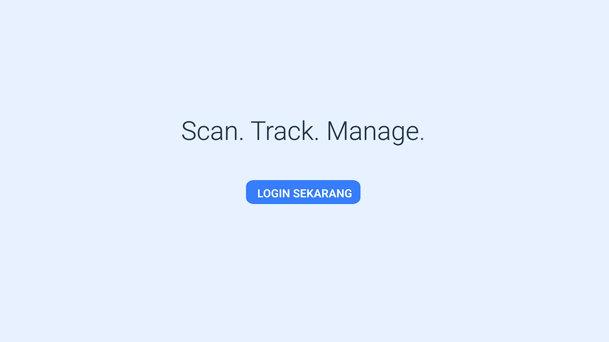

<div align="center">


# TamuQ — Smart Library Guestbook & Management System

### *Elevating Campus Library Experience through Digital Innovation*

<br/>

[](https://vuejs.org/)
[](https://vitejs.dev/)
[](https://tailwindcss.com/)
[](https://laravel.com/)
[](https://pinia.vuejs.org/)
[](https://webassembly.org/)
[](#-hak-cipta--hki)
[](LICENSE)

<br/>

> **"Dari buku tamu kertas ke sistem digital terintegrasi — TamuQ hadir untuk masa depan perpustakaan kampus."**

<br/>

[🚀 Mulai Sekarang](#-quick-start--instalasi) · [✨ Fitur Lengkap](#-fitur-unggulan) · [🏗 Arsitektur](#️-arsitektur-teknologi-tech-stack) · [🎥 Demo](#-demo-visual)

</div>

---

## 🎥 Demo Visual

<div align="center">

<a href="src/assets/web_demo.mp4" title="Klik untuk melihat demo TamuQ">
  
  <br/>
  <sub>▶ &nbsp;<strong>Klik thumbnail di atas</strong> untuk melihat video demo lengkap · <code>src/assets/web_demo.mp4</code></sub>
</a>

<br/><br/>

Atau putar langsung di browser menggunakan tag HTML berikut:

```html
<video controls width="100%" style="border-radius:12px;">
  <source src="src/assets/web_demo.mp4" type="video/mp4" />
  Browser Anda tidak mendukung pemutaran video.
</video>
```

</div>

---

## 📖 Tentang TamuQ

**TamuQ** adalah **Sistem Informasi Perpustakaan Pintar** yang dikembangkan khusus untuk Jurusan Teknik Informatika dan Komputer (JTIK), Universitas Negeri Makassar (UNM). Sistem ini lahir dari kebutuhan nyata akan transformasi digital di lingkungan perpustakaan kampus — menggantikan proses manual yang lambat, rawan kesalahan, dan tidak efisien.

<br/>

### 🔍 Masalah yang Diselesaikan

| ❌ Kondisi Konvensional | ✅ Solusi dengan TamuQ |
|---|---|
| Buku tamu fisik yang mudah rusak dan susah diaudit | Check-in digital via QR Code, tercatat otomatis |
| Tidak ada data kunjungan real-time untuk analisis | Dashboard analitik dengan grafik tren kunjungan |
| Proses peminjaman buku manual dan lambat | Manajemen sirkulasi buku digital & real-time |
| Pengajuan surat bebas pustaka berbasis kertas | Pengajuan & validasi surat 100% paperless online |
| Tidak ada visibilitas data demografi pengunjung | Visualisasi demografis per program studi (PTIK & TEKOM) |
| Akses monitoring hanya saat petugas hadir | Kendali status operasional perpustakaan dari mana saja |

<br/>

> **TamuQ bukan sekadar aplikasi pencatat tamu** — ini adalah ekosistem manajemen perpustakaan modern yang menghubungkan mahasiswa, staf, dan data secara mulus dalam satu platform terintegrasi.

---

## ✨ Fitur Unggulan

### 👥 Fitur Pengunjung / Mahasiswa (Role: `pengunjung`)

Setiap mahasiswa yang terdaftar mendapatkan akses ke panel user yang personal dan intuitif:

| Fitur | Deskripsi |
|---|---|
| 📊 **Dashboard Interaktif** | Ringkasan status kunjungan, informasi perpustakaan, dan akses cepat ke semua layanan |
| 🔲 **QR Code Generator** | Generate QR Code unik milik sendiri untuk proses check-in kilat tanpa antri |
| 📚 **Layanan Buku** | Lihat katalog koleksi buku, cek ketersediaan, dan riwayat peminjaman secara real-time |
| 🕒 **Riwayat Kunjungan** | Rekam jejak lengkap semua kunjungan ke perpustakaan beserta timestamp akurat |
| 📦 **Pengajuan Donasi Buku** | Formulir pengajuan donasi buku digital lengkap dengan tracking status persetujuan |
| 📄 **Surat Bebas Pustaka Online** | Ajukan surat keterangan bebas pustaka secara digital — tanpa perlu datang ke loket! |
| ⚙️ **Pengaturan Profil** | Kelola data pribadi, foto profil, dan preferensi akun secara mandiri |

<br/>

### 🛠️ Fitur Administrator / Staff Perpustakaan (Role: `staff`, `admin`, `superadmin`)

Panel staff dirancang untuk efisiensi operasional dan insight berbasis data:

| Fitur | Deskripsi |
|---|---|
| 📈 **Dashboard Analitik** | Overview real-time: total koleksi, pengunjung hari ini, peminjaman aktif + status operasional perpustakaan |
| 📉 **Grafik Tren Kunjungan** | Line chart interaktif via `LineChart.vue` dengan filter Hari Ini / Minggu Ini / Bulan Ini / Tanggal Kustom |
| 🏫 **Demografis Prodi** | Bar chart `BarGraph.vue` visualisasi distribusi pengunjung berdasarkan program studi (PTIK & TEKOM) |
| 📡 **Scan QR Code Pengunjung** | Scan QR Code mahasiswa langsung dari browser menggunakan **WebAssembly** (`zxing_reader.wasm`) — tanpa aplikasi tambahan! |
| 📖 **Manajemen Inventaris Buku** | CRUD lengkap koleksi buku: tambah, edit, hapus, dan kelola status peminjaman |
| 📋 **Validasi Surat Bebas Pustaka** | Review, setujui, atau tolak pengajuan surat dari mahasiswa dengan alur approval yang jelas |
| 👤 **Manajemen Akun** | Kelola seluruh akun pengguna — khusus untuk role `admin` dan `superadmin` |
| 🔐 **Kendali Status Perpustakaan** | Buka/tutup akses masuk perpustakaan secara real-time langsung dari dashboard |
| ⚙️ **Pengaturan Staff** | Konfigurasi profil dan preferensi akun petugas |

<br/>

> 💡 **Sistem akses berbasis peran** (Role-Based Access Control) memastikan setiap pengguna hanya bisa mengakses fitur sesuai otoritasnya. Percobaan akses tidak sah akan ditolak dengan notifikasi elegan.

---

## 🗺️ Peta Alur Sistem (User Flow)

```
[ Landing Page (/) ]
       │
       ├── [ Login (/login) ] ──────────────────────────────────┐
       │                                                         │
       └── [ Register (/register) ]                             │
                                                                 ▼
                                                    ┌────────────────────────┐
                                                    │   Auth Guard (Pinia)   │
                                                    │   useAuthStore         │
                                                    └─────────┬──────────────┘
                                                              │
                       ┌──────────────────────────────────────┴──────────────────────────────────┐
                       │                                                                          │
              Role: pengunjung                                                          Role: staff/admin/superadmin
                       │                                                                          │
                       ▼                                                                          ▼
         ┌─────────────────────────┐                                              ┌──────────────────────────────────┐
         │   Panel User (/user/)   │                                              │   Panel Staff (/staff/)          │
         ├─────────────────────────┤                                              ├──────────────────────────────────┤
         │  • dashboard            │                                              │  • dashboard (semua role)        │
         │  • qr                   │                                              │  • scan-qr (staff only)          │
         │  • riwayat              │                                              │  • riwayat-pengunjung            │
         │  • layanan-buku         │                                              │  • manajemen-buku                │
         │  • surat-bebas          │                                              │  • pengajuan-surat               │
         │  • donasi               │                                              │  • manajemen-akun (admin only)   │
         │  • pengaturan           │                                              │  • pengaturan                    │
         └─────────────────────────┘                                              └──────────────────────────────────┘
```

---

## 🏗️ Arsitektur Teknologi (Tech Stack)

<div align="center">

| Lapisan | Teknologi | Versi | Peran |
|---|---|---|---|
| **Core Framework** | [Vue.js](https://vuejs.org/) | `^3.5.24` | SFC, Composition API, `<script setup>` |
| **Build Tool** | [Vite](https://vitejs.dev/) | `^7.2.2` | Bundler ultra-cepat untuk development & production |
| **Styling** | [Tailwind CSS](https://tailwindcss.com/) | `^4.1.17` | Utility-first CSS untuk desain responsif modern |
| **State Management** | [Pinia](https://pinia.vuejs.org/) | `^3.0.4` | Auth state, session token, role management |
| **Routing** | [Vue Router](https://router.vuejs.org/) | `^4.6.3` | SPA routing dengan navigation guard berbasis peran |
| **HTTP Client** | [Axios](https://axios-http.com/) | `^1.13.2` | Komunikasi REST API ke backend Laravel |
| **Charting** | [Chart.js](https://www.chartjs.org/) + [vue-chartjs](https://vue-chartjs.org/) | `^4.5.1` | Visualisasi data analitik (line & bar chart) |
| **QR Generator** | [qrcode.vue](https://github.com/scopewu/qrcode.vue) | `^3.6.0` | Generate QR Code unik per user |
| **QR Scanner** | [vue-qrcode-reader](https://github.com/gruhn/vue-qrcode-reader) + **WebAssembly** | `^5.7.3` | Scan QR Code di browser via kamera — powered by ZXing WASM |
| **Notifikasi** | [SweetAlert2](https://sweetalert2.github.io/) | `^11.26.17` | Dialog konfirmasi & notifikasi yang elegan |
| **Export Data** | [SheetJS (xlsx)](https://sheetjs.com/) + [file-saver](https://github.com/eligrey/FileSaver.js) | `^0.18.5` | Export data ke format Excel |
| **Icons** | [@heroicons/vue](https://heroicons.com/) | `^2.2.0` | Ikon SVG berkualitas tinggi konsisten di seluruh UI |

</div>

<br/>

### 🔮 Keunggulan Teknis yang Menonjol

- **⚡ WebAssembly QR Decoder** — Scan QR Code menggunakan `public/wasm/zxing_reader.wasm`, memungkinkan decoding di sisi browser dengan performa mendekati native tanpa dependensi server.
- **🛡️ Role-Based Navigation Guard** — `router/index.js` mengimplementasikan guard yang mengecek role secara asinkron via `useAuthStore().initializeAuth()` sebelum setiap navigasi, mencegah akses tidak sah.
- **💾 Safe Auth Persistence** — `stores/auth.js` hanya menyimpan field aman (`id_user`, `role`, `nama_lengkap`, `foto_profil`) ke `localStorage`, bukan keseluruhan objek user.
- **📊 Adaptive Analytics Chart** — Line chart pada dashboard staff mampu mendeteksi kunjungan di luar jam kerja (di luar 08:00–17:00) secara otomatis dan menandainya dengan warna merah.

---

## 🚀 Quick Start — Instalasi

### Prasyarat

Pastikan sistem Anda sudah terpasang:
- **Node.js** `>= 18.x` — [Download Node.js](https://nodejs.org/)
- **npm** `>= 9.x` (termasuk dalam paket Node.js)
- **Git** — [Download Git](https://git-scm.com/)
- Backend **TamuQ API** (Laravel) yang sudah berjalan

<br/>

### Langkah Instalasi

**1. Clone repositori**

```bash
git clone https://github.com/MuhammadIkramM/TamuQ-Production.git
cd TamuQ-Production/tamuq-frontend
```

**2. Instal dependensi**

```bash
npm install
```

**3. Konfigurasi environment**

Buat file `.env.development` untuk kebutuhan lokal (atau sesuaikan `.env.production` yang sudah tersedia):

```bash
# .env.development
VITE_API_BASE_URL=http://localhost:8000
VITE_STORAGE_URL=http://localhost:8000/storage
```

```bash
# .env.production (sudah dikonfigurasi)
VITE_API_BASE_URL=https://tamuq.my.id
VITE_STORAGE_URL=https://tamuq.my.id/storage
```

> **Catatan:** Variabel `VITE_API_BASE_URL` mengarah ke base URL backend TamuQ (Laravel). Pastikan backend sudah berjalan dan CORS dikonfigurasi untuk menerima request dari origin frontend Anda.

**4. Jalankan mode development**

```bash
npm run dev
```

Aplikasi akan berjalan di `http://localhost:5173` secara default.

**5. Build untuk production**

```bash
npm run build
```

Hasil build akan tersimpan di direktori `dist/` dan siap dideploy ke web server.

**6. Preview build production secara lokal**

```bash
npm run preview
```

<br/>

### Struktur Direktori Utama

```
tamuq-frontend/
├── public/
│   ├── tamuqicon.png          # Favicon & logo utama aplikasi
│   ├── og-image.png           # Open Graph image untuk SEO/sosmed
│   ├── robots.txt             # Konfigurasi SEO crawler
│   ├── sitemap.xml            # Sitemap untuk mesin pencari
│   └── wasm/
│       └── zxing_reader.wasm  # WebAssembly module untuk QR Code decoding
├── src/
│   ├── assets/
│   │   ├── tamuqicon.png      # Logo dalam src (digunakan komponen Vue)
│   │   ├── unmlogo.png        # Logo UNM untuk footer
│   │   ├── thumbnailvid.png   # Thumbnail preview video demo
│   │   ├── web_demo.mp4       # Video demo lengkap aplikasi
│   │   ├── pic1-4.jpeg        # Foto slideshow hero section
│   │   └── orang1-5.png       # Foto testimoni landing page
│   ├── components/
│   │   └── charts/
│   │       ├── BarGraph.vue   # Komponen bar chart (demografis prodi)
│   │       └── LineChart.vue  # Komponen line chart (tren kunjungan)
│   ├── layouts/
│   │   ├── SideBarStaff.vue   # Layout sidebar untuk panel staff
│   │   └── BarUser.vue        # Layout navbar untuk panel user
│   ├── router/
│   │   └── index.js           # Konfigurasi routing & navigation guard
│   ├── stores/
│   │   └── auth.js            # Pinia store: auth, session, role management
│   ├── views/
│   │   ├── LandingPage.vue    # Halaman utama / beranda publik
│   │   ├── Auth/
│   │   │   ├── LoginView.vue
│   │   │   └── RegisterView.vue
│   │   ├── Staff/
│   │   │   ├── DashboardStaff.vue    # Dashboard analitik staff
│   │   │   ├── ScanQR.vue            # Scanner QR Code via kamera
│   │   │   ├── RiwayatPengunjung.vue # Histori kunjungan seluruh user
│   │   │   ├── ManajemenBuku.vue     # CRUD inventaris buku
│   │   │   ├── PengajuanSurat.vue    # Validasi surat bebas pustaka
│   │   │   ├── ManajemenAkun.vue     # Manajemen akun (admin only)
│   │   │   └── PengaturanStaff.vue   # Pengaturan profil staff
│   │   └── User/
│   │       ├── DashboardUser.vue     # Dashboard personal mahasiswa
│   │       ├── QRCodeUser.vue        # Tampil & generate QR Code
│   │       ├── RiwayatKunjunganUser.vue  # Riwayat kunjungan pribadi
│   │       ├── LayananBukuUser.vue   # Katalog & layanan buku
│   │       ├── PengajuanSuratBebasUser.vue # Pengajuan surat
│   │       ├── PengajuanDonasiBukuUser.vue # Pengajuan donasi buku
│   │       └── PengaturanUser.vue    # Pengaturan profil user
│   ├── api.js                 # Instance Axios dengan base URL & interceptor
│   ├── main.js                # Entry point aplikasi Vue
│   └── style.css              # Global CSS & Tailwind base imports
├── .env.production            # Konfigurasi environment production
├── vite.config.js             # Konfigurasi build Vite
├── tailwind.config.js         # Konfigurasi Tailwind CSS
└── package.json               # Dependensi & scripts npm
```

---

## 🎨 Panduan Branding & Desain

TamuQ menggunakan sistem desain yang konsisten dan berciri khas:

| Elemen | Nilai |
|---|---|
| **Primary Color** | `#00555A` — Teal gelap (warna JTIK UNM) |
| **Accent Color** | `#F26430` — Oranye cerah (CTA & highlight) |
| **Background** | `#EBF2FA` — Biru muda lembut |
| **Font Family** | Inter / Sans-serif |
| **Border Radius** | `rounded-2xl` hingga `rounded-3xl` (modern & friendly) |
| **Animasi** | Transisi halus 300ms, ping indicator, slide hero carousel |

---

## 🤝 Kontribusi

Proyek ini dikembangkan dalam konteks penelitian skripsi di lingkungan JTIK UNM dan saat ini **tidak membuka kontribusi eksternal secara umum**. Jika Anda adalah civitas akademika JTIK UNM atau memiliki kepentingan resmi, silakan hubungi pengembang melalui kontak yang tersedia.

Untuk laporan bug atau saran fitur dalam lingkup internal, silakan buka *Issue* pada repositori ini.

---

## 📜 Hak Cipta & HKI

<div align="center">

```
╔══════════════════════════════════════════════════════════════════╗
║              HAK KEKAYAAN INTELEKTUAL — TERDAFTAR               ║
╠══════════════════════════════════════════════════════════════════╣
║  Nama Program  : TamuQ - Smart Library Guestbook &              ║
║                  Management System                               ║
║  Kategori      : Program Komputer                               ║
║  Instansi      : Jurusan Teknik Informatika dan Komputer (JTIK) ║
║                  Universitas Negeri Makassar (UNM)              ║
║  Lembaga HKI   : DJKI — Direktorat Jenderal Kekayaan           ║
║                  Intelektual, Kemenkumham RI                    ║
║  Status        : ✅ Terdaftar & Dilindungi Undang-Undang        ║
╚══════════════════════════════════════════════════════════════════╝
```

**© 2024 TamuQ — Dikembangkan oleh Muhammad Ikram M.**

Sistem ini merupakan karya intelektual yang telah terdaftar secara resmi sebagai **Program Komputer** di Direktorat Jenderal Kekayaan Intelektual (DJKI), Kementerian Hukum dan HAM Republik Indonesia.

Seluruh kode sumber, desain antarmuka, alur sistem, dan aset visual yang terdapat dalam repositori ini **dilindungi hak cipta**. Reproduksi, distribusi, atau modifikasi tanpa izin tertulis dari pemilik hak cipta merupakan pelanggaran hukum.

<br/>

[](https://unm.ac.id/)
[](https://ft.unm.ac.id/)
[](https://dgip.go.id/)

</div>

---

<div align="center">

**Dibuat dengan ❤️ untuk digitalisasi perpustakaan kampus Indonesia**

<br/>

*TamuQ — Karena setiap kunjungan ke perpustakaan itu berharga.*

</div>
